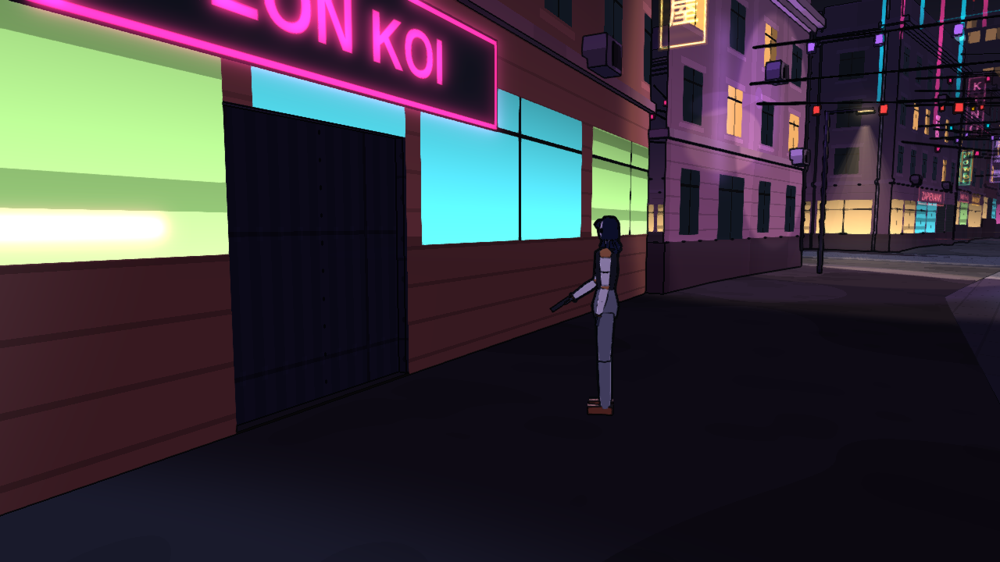

# Seki Senshi

Cyberpunkowa gra akcji RPG w przeglądarce i na telefonie, z widokiem FPP i TPP oraz cel shadingiem w duchu anime. Akcja dzieje się w **Lublinie 2077**. Prawdziwe centrum miasta zbudowane z danych OpenStreetMap i lidaru przykrywają neony, nadbudowy i megawieże na horyzoncie. Bohaterka budzi się w klinice doktora Mori bez pamięci własnego imienia, a fixer Kaito nazywa ją **Seki Senshi**.

Domyślnym językiem gry jest angielski, a polski można włączyć w opcjach ([ADR-0056](docs/adr/0056-jezyki-gry.md)).



## Uruchomienie

Wymagania: Node 22+ i pnpm 10.

```bash
pnpm install
pnpm dev                     # http://localhost:5173
pnpm build && pnpm preview   # build produkcyjny, http://localhost:4173
```

Parametry URL:

| Parametr | Działanie |
|---|---|
| `?seed=123` | stałe ziarno nowej gry |
| `?reference` | deterministyczny kadr do testów migawkowych |
| `?quality=low\|medium\|high` | jakość grafiki niezależnie od ustawień |
| `?crowd=off\|low\|medium\|high` | gęstość tłumu (domyślnie jak jakość) |
| `?traffic=off\|…` | ruch aut i trolejbusów |
| `?city=off` | bez city kitu i rekwizytów, gołe bryły |
| `?models=off` | postacie proceduralne zamiast modeli VRM |
| `?audio=off` | czysta synteza zamiast nagrań |
| `?touch` | sterowanie dotykowe na komputerze |

## Co jest w grze

- **Miasto.** Krakowskie Przedmieście, Stare Miasto, Podzamcze z targiem pod wiaduktem i Nabrzeże Bystrzycy z danych mapowych:
  - ulice, budynki, zabytki, teren, meble uliczne i oznakowanie poziome;
  - mieszkańcy na chodnikach;
  - ruch aut i trolejbusów ze skrętami na skrzyżowaniach;
  - zegar doby z harmonogramami;
  - metro między dzielnicami;
  - radio.
- **Fabuła.** Wątek główny w dwóch aktach z zakończeniami, napisany w ink. Do tego wspomnienia jako progresja diegetyczna, spotkania uliczne i 6 frakcji z reputacją.
- **Kontrakty.** 7 rodzajów zleceń proceduralnych od fixerów, z wariantami, hakami, odznakami stylu i rangą na karcie podsumowania.
- **Walka.**
  - 8 broni w 7 klasach, z modami;
  - celowanie z przyłożenia (ADS);
  - strefy trafień;
  - walka wręcz z blokiem i parowaniem;
  - zryw;
  - zdolności cyberware.
- **Skradanie i hackowanie.**
  - świadkowie, pościg (heat), kamery;
  - skaner z 5 quickhackami i włamania (Breach) z daemonami;
  - przebrania.
- **Postać.**
  - ekwipunek z porównaniem;
  - odzież i pancerz według stref ciała;
  - klinika z wszczepami i pojemnością cyberware;
  - sklepy, łupy, karta postaci, dziennik, mapa miasta.
- **Wnętrza.** Klinika, bar Neon Koi i biuro Tessen, z drzwiami automatycznymi.
- **Zapis.** Trzy sloty w IndexedDB, szybki zapis, suma kontrolna i migracje schematu.
- **Telefon.** Dotykowa gałka i łuk akcji, układ HUD dla 667×375 i 800×370, jakość `low`.
- **NPR.**
  - toon shading z pasmami światła i rim light;
  - kontury z G-bufora;
  - neony z poświatą;
  - deszcz i mokry asfalt;
  - grading.

W toku i w planie: autozapis, rozwój postaci z poziomami i atrybutami ([ADR-0059](docs/adr/0059-rozwoj-postaci-i-skalowanie.md)), żywe miasto z assetów CC0 ([ADR-0058](docs/adr/0058-zywe-miasto-assety-cc0.md)), głosy z TTS i zaczepki NPC ([ADR-0060](docs/adr/0060-glosy-i-dzwiek.md)), ekran ładowania ([ADR-0057](docs/adr/0057-ekran-ladowania.md)). Kolejność i priorytety opisują [`docs/backlog.md`](docs/backlog.md) i [`docs/audyt-luk.md`](docs/audyt-luk.md).

## Sterowanie

| Klawisz | Akcja |
|---|---|
| WASD / strzałki | ruch |
| Shift | sprint |
| C | kucanie |
| Spacja | skok |
| Mysz (kliknij w ekran, żeby przechwycić kursor) | rozglądanie |
| LPM / PPM | strzał / celowanie albo blok wręcz |
| R | przeładowanie |
| 1–3, kółko myszy | wybór broni |
| X | schowanie i wyciągnięcie broni |
| E albo F | rozmowa i interakcja |
| Z albo środkowy przycisk myszy (przytrzymaj) | skaner i quickhacki |
| Alt | zryw |
| Q | zdolność cyberware |
| H | apteczka |
| V | FPP / TPP |
| I / Tab / J / M | ekwipunek / karta postaci / dziennik / mapa |
| T | telefon |
| B | radio |
| F5 / F9 | szybki zapis / odczyt |
| Esc albo P | pauza (zapis, wczytywanie, ustawienia) |

Klawisze zmienia się w ustawieniach. Pad (standard mapping) obsługuje rozgrywkę.

Na telefonie i tablecie (wykrywane automatycznie):
- grę obracamy poziomo;
- lewa połowa ekranu to gałka ruchu, prawa to rozglądanie;
- wokół przycisku strzału są przeładowanie, skaner, zryw i „więcej”;
- „Use” pojawia się przy rzeczach, których można użyć.

Dialog wybiera się na kole kwestii ([ADR-0039](docs/adr/0039-dialog-na-kole.md)) myszą, cyfrą, strzałkami albo tapnięciem.

## Dane mapowe ([ADR-0042](docs/adr/0042-lublin-z-danych-mapowych.md))

Miasto powstaje narzędziem `tools/osm-import`, a gra nie łączy się z siecią. Wierności topografii pilnuje rejestr [`docs/topografia.md`](docs/topografia.md).

```bash
pnpm osm:fetch      # pobiera OSM i teren do data/ (sieć, ręcznie)
pnpm osm:build      # generuje packages/sim/src/content/lublin/*.generated.ts offline z data/
pnpm osm:props      # meble uliczne z planu i OSM
pnpm osm:preview <katalog>   # podgląd SVG dystryktów
```

- Mapa: © OpenStreetMap contributors, licencja [ODbL 1.0](https://www.openstreetmap.org/copyright).
- Teren: GUGiK (geoportal.gov.pl), NMT 1 m, zapasowo EU-DEM v1.1.
- Szczegóły: [`data/osm/ATTRIBUTION.md`](data/osm/ATTRIBUTION.md).
- Modele, dźwięki i paczki miasta to wyłącznie zasoby CC0. Źródła i licencje są w README katalogów `packages/app/public/*`.

## Struktura

```
packages/
  core/         domena (czyste TS): porty, zdarzenia, komendy, walka, przedmioty, cyberware, hacking, kontrakty, reputacja, questy, progresja, zapis
  sim/          ECS (miniplex), systemy (kolejność w createSystems), AI, treść miasta, ruch, tłum, replay
  engine/       adaptery Babylon.js (tylko przez babylon.ts): renderer, NPR, miasto z danych, kamera, wejście, audio
  narrative/    runtime ink i treść (.ink)
  ui/           React + Zustand: HUD, dotyk, dialogi, menu, katalogi i18n
  persistence/  IndexedDB, kodek zapisu, migracje
  app/          kompozycja: sesja, kontrolery, prezentery, punkt wejścia
e2e/            Playwright: rozruch, migawka NPR, budżety wydajności, dotyk, zapis
tools/          osm-import, glitch-scan, i18n-scan, city_kit (assety CC0), budżety wydajności, e2e.sh
docs/           plan, ADR-y, backlog, audyt luk, rejestr glitchy, topografia
data/           surowe dane mapowe i teren
```

## Bramki jakości

```bash
pnpm typecheck      # tsc --noEmit we wszystkich pakietach
pnpm lint           # eslint: bez any, bez Math.random/Date.now w core i sim, limity linii (ADR-0031)
pnpm depcheck       # dependency-cruiser: kierunek zależności, brak cykli
pnpm test:coverage  # vitest z progami pokrycia
pnpm e2e e2e/<spec>.spec.ts   # jeden spec lokalnie (blokada przeglądarki, własny port)
pnpm test:e2e       # pełny zestaw Playwright (CI)
pnpm ci             # wszystko po kolei
```

Logikę i UI sprawdzają testy sesji bez renderera i testy komponentów ([ADR-0046](docs/adr/0046-strategia-testow-e2e.md)). Determinizm pilnuje złoty hash w `packages/sim/test/determinism.test.ts`. Skany z zapadką (`tools/glitch-scan`, `tools/i18n-scan`) liczą znane rodzaje glitchy i polskie literały poza katalogami, a ich liczniki mogą tylko spadać.

## Jak pracujemy

- Zasady repozytorium dla ludzi i agentów: [`CLAUDE.md`](CLAUDE.md). Decyzje: [`docs/adr/`](docs/adr/README.md).
- Glitche: rejestr [`docs/glitches.md`](docs/glitches.md) i archiwum, proces z [ADR-0054](docs/adr/0054-proces-glitchy.md).
- Zespół agentów w `.claude/agents/`:
  - orkiestrator;
  - łowca glitchy;
  - naprawiacz;
  - budowniczy funkcji;
  - weryfikator;
  - kurator topografii.
- Każda zmiana idzie własną gałęzią i własnym PR-em, z niezależną weryfikacją przed merge'em.
